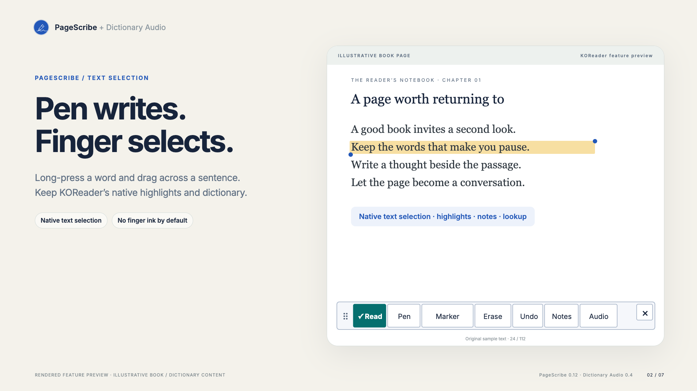
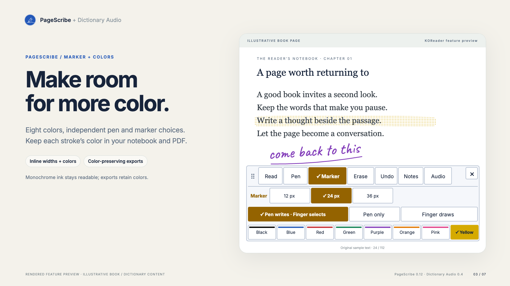
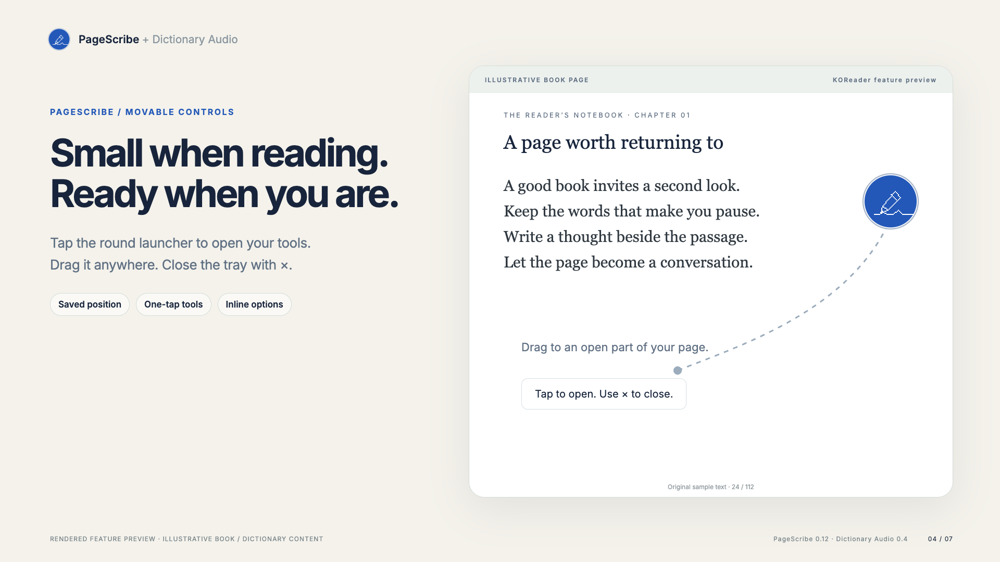
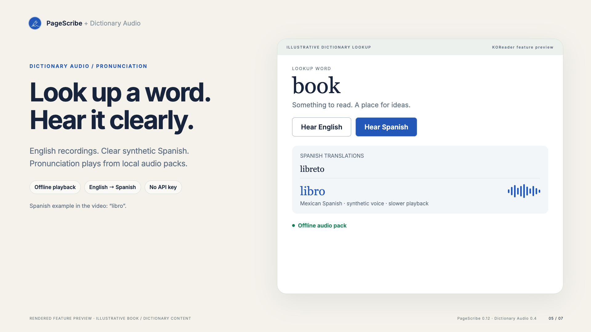
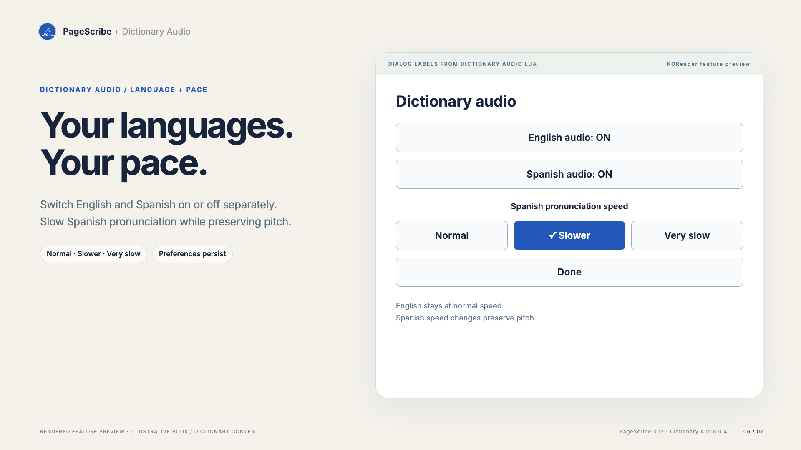
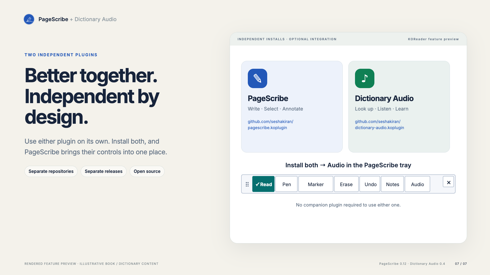

# Feature gallery

These are rendered feature previews, not photographs or recordings of a tablet. Toolbars use the PageScribe Lua layouts; Dictionary Audio labels/states come from its Lua dialog. Book text and surrounding dictionary presentation are illustrative. Monochrome screens keep readable black ink; the previews show the color interface.

- [Writing](01-write.png)
- [Native finger text selection](02-select.png)
- [Marker and colors](03-colors.png)
- [Movable launcher](04-tray.png)
- [Dictionary pronunciation](05-dictionary-audio.png)
- [Audio preferences](06-audio-settings.png)
- [Independent installs, shared controls](07-together.png)

The Remotion source and reproduction instructions live in [PageScribe’s media-demo directory](https://github.com/seshakiran/pagescribe.koplugin/tree/main/media-demo). The full video is attached to each repository’s plugin release. It includes an original sound bed and one synthetic Spanish pronunciation example, “libro”. Font licenses and audio provenance are included with the Remotion source.

## Screenshots

| Write with the pen | Select text with a finger |
| --- | --- |
|  |  |

| Marker and colors | Small, movable controls |
| --- | --- |
|  |  |

| Pronunciation | Languages and speed |
| --- | --- |
|  |  |

